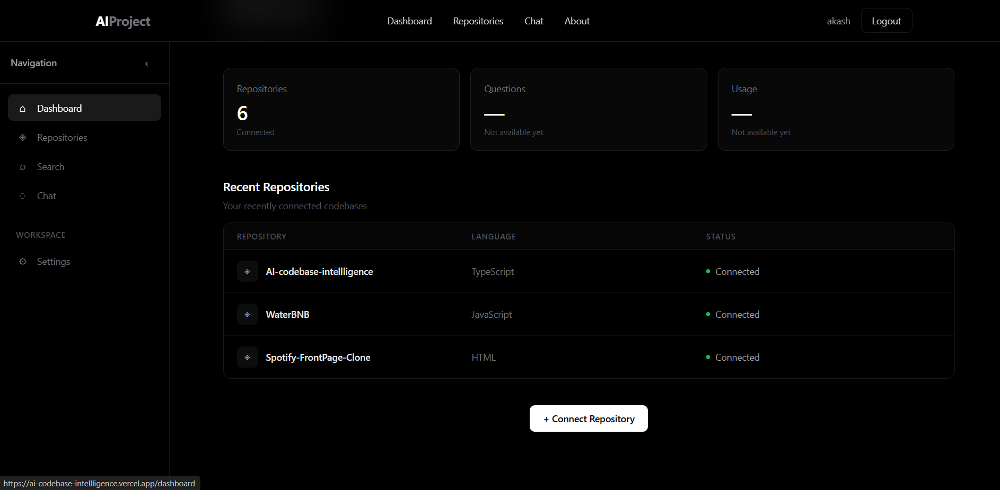
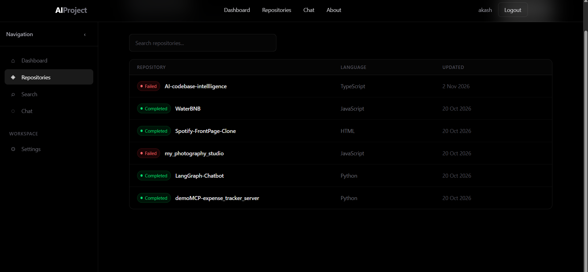
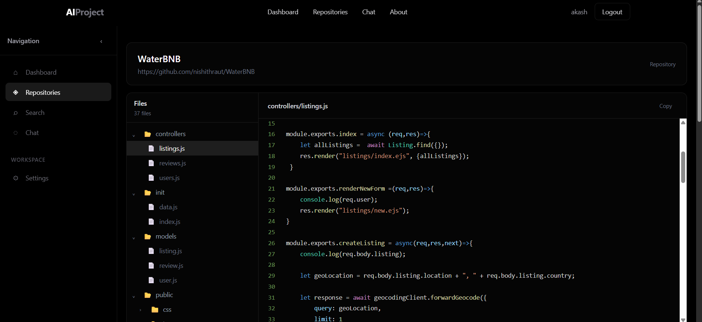
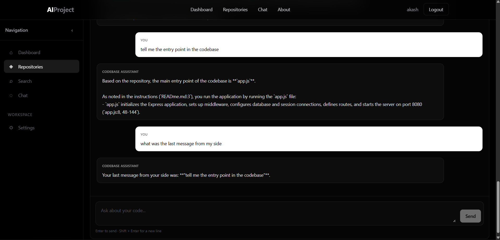
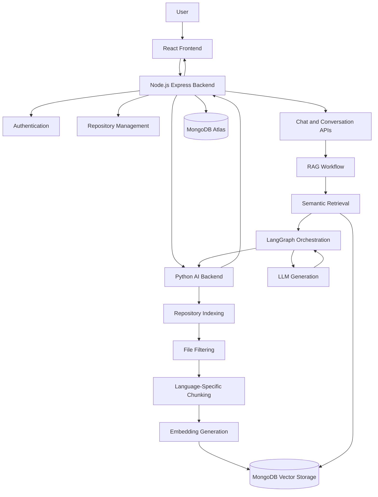

# AI Codebase Intelligence

An AI-powered codebase intelligence platform that helps developers understand, explore, and interact with GitHub repositories through intelligent code retrieval and repository-aware AI conversations.

The platform combines repository ingestion, language-aware code chunking, semantic search, Retrieval-Augmented Generation (RAG), and graph-based AI orchestration to make large codebases easier to understand.

---

## Screenshots

<!-- Add your actual frontend screenshots to the screenshots/ directory -->

### Dashboard


### Repository Explorer


### Code Viewer


### AI Assistant


---

## Key Features

- **GitHub Integration:** Connect and ingest GitHub repositories.
- **Repository Intelligence:** Explore repository structures, directories, and source files.
- **Language-Aware Chunking:** Split source code into meaningful chunks using language-specific parsing strategies.
- **Intelligent File Filtering:** Exclude unnecessary, generated, binary, and third-party files from the indexing pipeline.
- **Semantic Code Search:** Retrieve relevant code using vector-based similarity search.
- **Repository-Aware AI Chat:** Ask questions about a connected codebase and receive contextually grounded responses.
- **RAG Pipeline:** Retrieve relevant code context and provide it to the AI generation workflow.
- **Graph-Based Orchestration:** Coordinate AI processing through structured workflows and conditional execution.
- **Conversation Management:** Maintain repository-related conversation history.
- **Observability:** Trace AI execution and monitor application behavior.
- **Evaluation and Testing:** Support testing of backend functionality and assessment of retrieval and response quality.

---

## System Architecture

The application consists of three independently managed services.



### Service Responsibilities

| Service | Responsibilities |
|---|---|
| Frontend | User interface, authentication flows, repository exploration, code visualization and AI conversations |
| Node.js Backend | Authentication, API management, repository operations, database access and service communication |
| Python AI Backend | Repository indexing, chunking, embeddings, retrieval, RAG and AI orchestration |

---

## Technology Stack

| Category | Technologies |
|---|---|
| Frontend | React, TypeScript, Vite, Tailwind CSS |
| Backend | Node.js, Express, TypeScript |
| AI Backend | Python, FastAPI |
| Database | MongoDB Atlas |
| AI Orchestration | LangGraph, LangChain |
| Vector Search | MongoDB Vector Search |
| Embedding Integration | Gemini Embedding API |
| LLM Integration | Pluggable LLM integration |
| Observability | LangSmith, Python logging |
| Testing | Pytest, HTTPX |

---

## How It Works

### 1. Repository Ingestion

Users connect their GitHub repositories through the application.

The backend communicates with GitHub services, retrieves repository information and source files, and stores the required repository metadata and file contents.

### 2. File Processing and Chunking

The Python backend processes repository files through a dedicated indexing pipeline.

The pipeline includes:

- File filtering and exclusion.
- File size and processing constraints.
- Language identification.
- Language-specific chunking.
- Chunk metadata generation.
- Chunk validation.

The chunking implementation uses Python AST for Python source files and rule-based parsing strategies for other supported languages.

Supported language-specific chunkers include:

- Python
- Java
- C++
- JavaScript
- Go
- Rust
- Jupyter Notebooks
- Other supported text-based formats

### 3. Embedding and Storage

Processed chunks are converted into vector embeddings.

The generated vectors and associated metadata are stored in MongoDB, enabling semantic retrieval of relevant repository content.

### 4. Retrieval-Augmented Generation

When a user submits a question:

1. The question is received by the application backend.
2. The AI backend processes the request.
3. Relevant repository context is retrieved through semantic search.
4. Retrieved code chunks are provided to the generation workflow.
5. The AI generates a response grounded in the retrieved repository context.
6. The response is returned to the frontend.

### 5. LangGraph Orchestration

The AI workflow uses LangGraph to organize processing into distinct nodes and conditional transitions.

This provides a structured approach to managing retrieval, context processing, generation, and workflow execution.

---

## Observability and Evaluation

The project incorporates observability into its AI processing architecture.

**Observability**
- LangSmith tracing for AI workflow execution.
- Project-level trace organization.
- Configurable application logging.
- Visibility into workflow execution and failures.
- Support for debugging retrieval and generation pipelines.

**Evaluation and Testing**

The architecture supports evaluating different stages of the AI pipeline, including:

- Retrieval relevance.
- Context quality.
- Response relevance.
- Groundedness of generated answers.
- API behavior and error handling.

Pytest and HTTPX are used for Python backend testing.

*Evaluation metrics and automated evaluation coverage should be updated as the evaluation suite evolves.*

---

## Project Structure

```text
ai-codebase-intelligence/
│
├── frontend/
│   └── src/
│       ├── components/
│       │   ├── auth/
│       │   ├── dashboard/
│       │   ├── layout/
│       │   └── repository/
│       ├── context/
│       ├── pages/
│       │   ├── chat/
│       │   ├── dashboard/
│       │   ├── repositories/
│       │   └── usage/
│       ├── routes/
│       ├── services/
│       └── types/
│
├── backend/
│   └── src/
│       ├── config/
│       ├── controllers/
│       ├── middleware/
│       ├── models/
│       ├── routes/
│       ├── services/
│       ├── utils/
│       └── app.ts
│
├── python-backend/
│   └── app/
│       ├── api/
│       │   └── routes/
│       ├── chunkers/
│       ├── core/
│       ├── db/
│       ├── embeddings/
│       ├── graphs/
│       ├── llm/
│       ├── repositories/
│       ├── services/
│       └── main.py
│
├── screenshots/
│   ├── dashboard.png
│   ├── repositories.png
│   ├── code-viewer.png
│   └── ai-chat.png
│
└── README.md
```

---

## Getting Started

### Prerequisites

- Node.js and npm
- Python 3.10+
- MongoDB Atlas account
- Git
- Required API credentials for configured integrations

### 1. Clone the Repository

```bash
git clone <YOUR_REPOSITORY_URL>

cd ai-codebase-intelligence
```

### 2. Frontend Setup

```bash
cd frontend

npm install

npm run dev
```

The Vite development server will start, typically at:

```text
http://localhost:5173
```

### 3. Node.js Backend Setup

```bash
cd backend

npm install

npm run dev
```

The backend runs on the port configured through its environment variables.

To create a production build:

```bash
npm run build

npm start
```

### 4. Python Backend Setup

Navigate to the Python backend:

```bash
cd python-backend
```

Create and activate a virtual environment.

**Windows:**

```bash
python -m venv venv

venv\Scripts\activate
```

**Linux / macOS:**

```bash
python -m venv venv

source venv/bin/activate
```

Install dependencies:

```bash
pip install -r requirements.txt
```

Start the FastAPI application:

```bash
uvicorn app.main:app --reload
```

---

## Environment Variables

Create separate `.env` files for the frontend, Node.js backend, and Python backend.

### Frontend

Configure the backend API base URL using the environment variable already defined in the frontend configuration.

### Node.js Backend

```env
PORT=5000
NODE_ENV=development

FRONTEND_URL=http://localhost:5173

MONGODB_URI=

JWT_SECRET=

INTERNAL_API_SECRET=
```

### Python AI Backend

```env
MONGODB_URI=
MONGODB_DATABASE=

GEMINI_API_KEY=

LOG_LEVEL=INFO

LANGSMITH_TRACING=true
LANGSMITH_API_KEY=
LANGSMITH_PROJECT=ai-codebase-intelligence
```

Keep all credentials in environment variables. Never commit actual secrets or production database credentials.

---

## Security

The application follows a service-oriented architecture with internal communication between the Node.js and Python backends.

Security considerations include:

- JWT-based authentication.
- Protected API routes.
- Password hashing.
- Internal API authentication between backend services.
- Environment-based secret management.
- Controlled access to repository data.
- Separation of frontend and backend responsibilities.

---

## Testing

Python backend tests can be executed using:

```bash
pytest
```

Frontend linting:

```bash
npm run lint
```

Frontend production build:

```bash
npm run build
```

---

## Deployment Architecture

The application is designed to deploy its three services independently.

| Component | Deployment |
|---|---|
| Frontend | Vercel |
| Node.js Backend | Render |
| Python AI Backend | Render |
| Database | MongoDB Atlas |

Each service communicates through configured environment variables and API endpoints.

---

## Future Improvements

- Advanced repository-level code analysis.
- Improved retrieval and ranking strategies.
- Expanded automated RAG evaluation.
- More advanced multi-agent workflows.
- Support for additional programming languages.
- Enhanced code dependency and relationship analysis.
- Improved indexing performance for large repositories.

---

## License

This project is currently maintained as a personal development project. Add an appropriate license before permitting external reuse or distribution.
